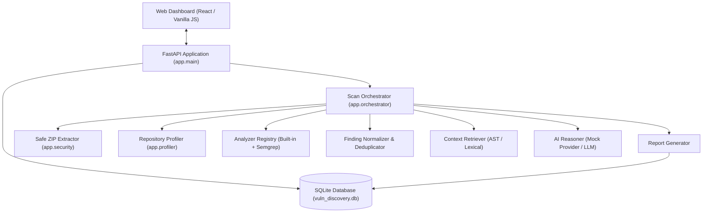
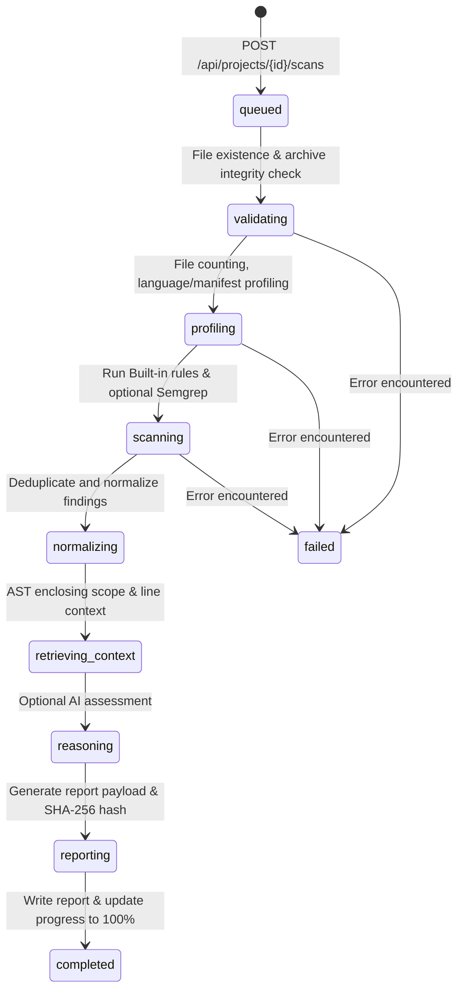

# Architecture & Data Flow

**Project ID:** 2026-27-CS-10  
**Project Title:** AI-Driven Vulnerability Discovery System  
**Institution:** Swami Keshwanand Institute of Technology, Management & Gramothan (SKIT), Jaipur  

---

## 1. Modular Monolith Architecture

The system is designed as a unified, defensive repository analysis platform partitioned into three module responsibilities:
- **Module A (Chaudhari Krishna):** Backend & AI Orchestration
- **Module B (Bhavesh Shah):** Frontend & Reporting
- **Module C (Gunwant Singh Hada):** Security Analysis & Repository Intelligence

---

## 2. Scan Lifecycle State Transitions

A scan progresses through explicit lifecycle states:

---

## 3. Trust Boundaries & Security Model

1. **Untrusted Input:**
   - All uploaded archives are treated as hostile.
   - Archive extraction enforces Zip-Slip prevention, symlink rejection, path traversal rejection, and strict decompression thresholds (40MB upload, 250MB expanded, 10MB per file).
2. **Zero Code Execution:**
   - Analysis is strictly static and lexical/AST-based.
   - The platform never executes project build scripts (`mvn`, `gradle`, `npm`, `pip`), test runners, or entry points during analysis.
3. **Data Redaction:**
   - Secrets identified in code are automatically masked using `redact_secret_text` before persistence, log generation, or UI presentation.
4. **AI Prompt Isolation:**
   - Repository code sent to the AI Reasoner is explicitly marked as untrusted data. Instructions embedded in comments, source files, or tests are ignored.
5. **Human Review Authority:**
   - Heuristic matches are labeled as `candidate` or `needs_review`. Only human reviewers can transition finding status to `confirmed` or `rejected`.

